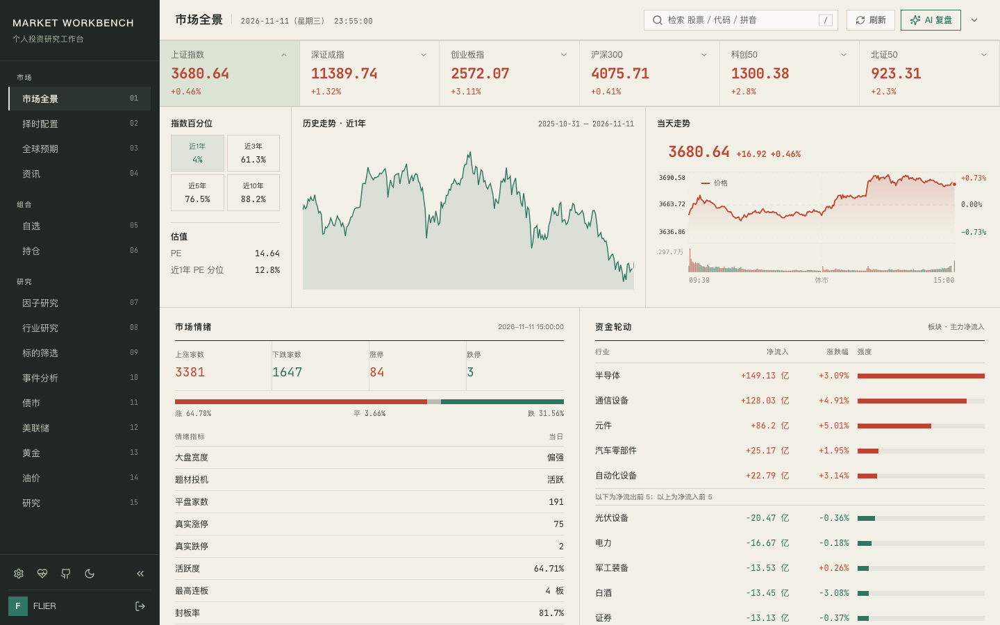
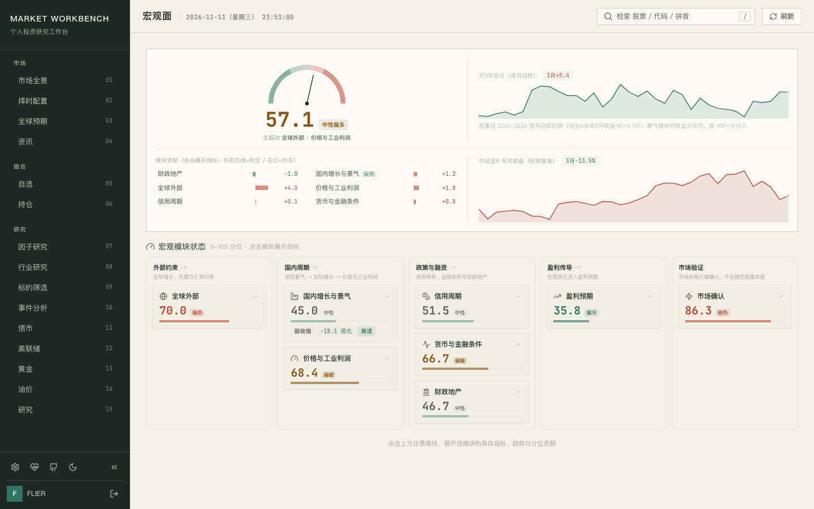
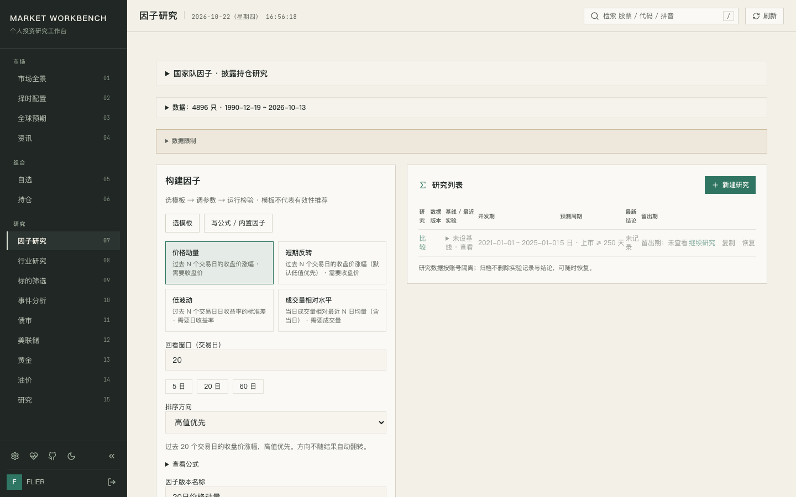
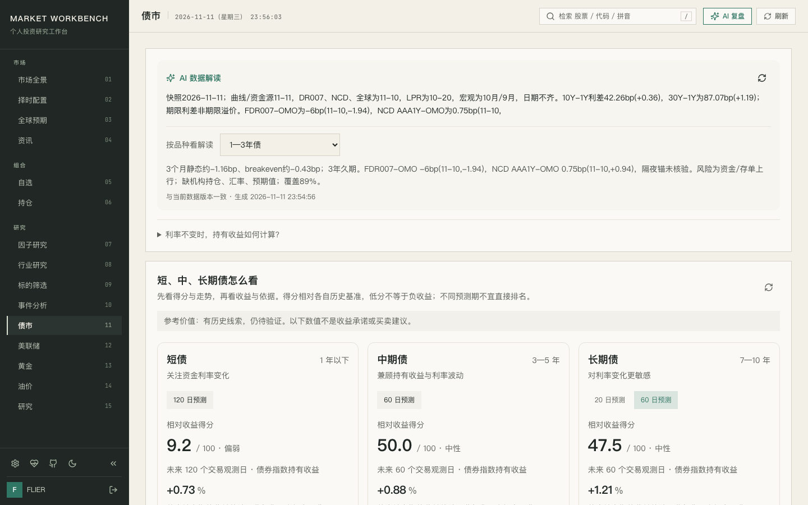
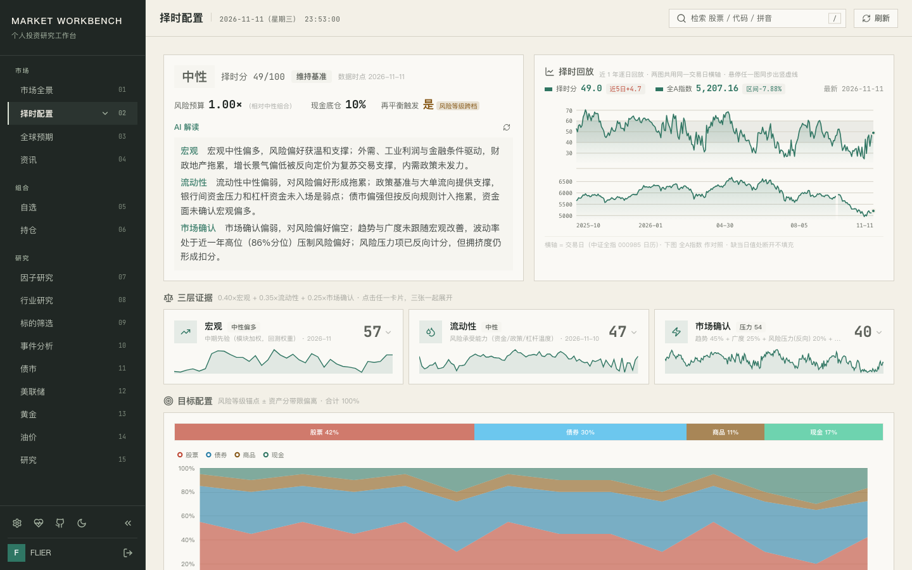
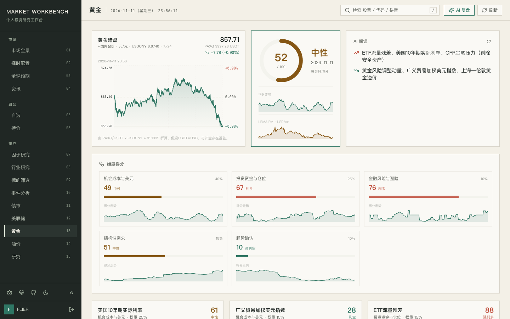
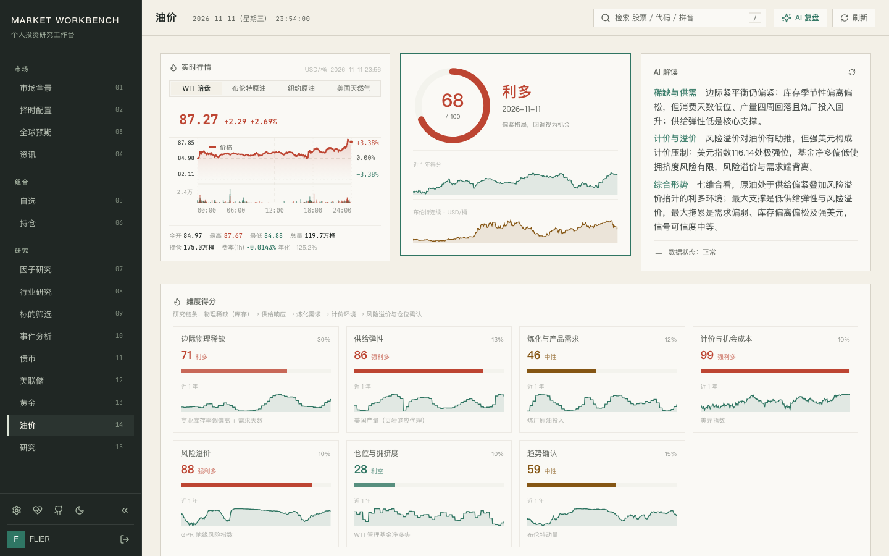
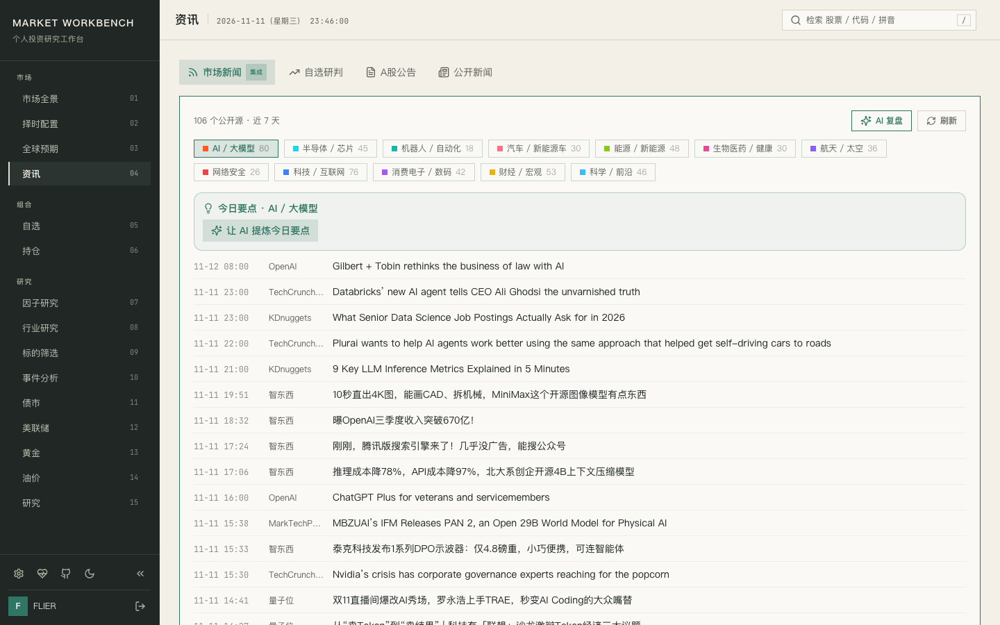
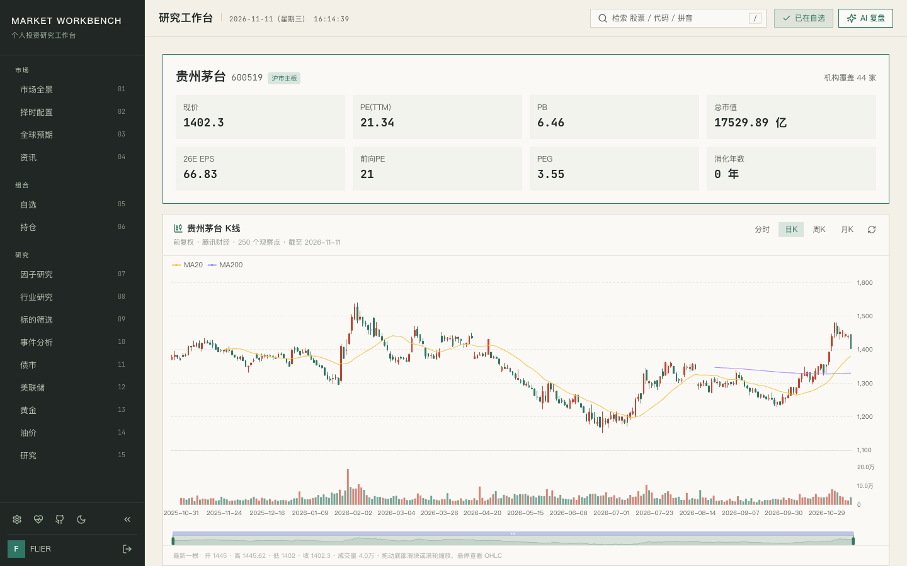

<p align="center"><b>简体中文</b> | <a href="README_en.md">English</a></p>

# Market Workbench

[](CHANGELOG.md)
[](https://www.python.org/)
[](https://react.dev/)
[](LICENSE)

本地自托管的 A 股市场研究工作台，兼顾港美市场。行情、财务、资金面、宏观、板块、择时配置、债市、黄金、油价、美联储、因子检验与公开资讯聚合于单一界面；数据留在本机，AI 连接由你提供，产品不输出荐股或交易指令。

当前 v1.8.2，改动集中在内存与安全：行业和板块评分重算跑在短命子进程中，同一时刻只允许一个，缓存命中不再重复解析磁盘快照，因子面板按日期分块读取；静态文件访问增加目录边界校验，评分定时任务失败不再报告成功。更早版本与尚未发版的实验性改动（债券候选先验、黄金环境 V3、因子实验台）见 [CHANGELOG.md](CHANGELOG.md)。

**为什么选它**

- **全本地**：FastAPI + React，账号、持仓、研报存于本机 `~/.market-workbench/`，无云端托管、无遥测。
- **数据零门槛**：东方财富、腾讯、新浪、AkShare、FRED、EIA、IMF、Polymarket/Kalshi 等公开接口，绝大多数无需 API key；核心依赖轻量秒装，重型数据源可选（未安装时对应端点返回 501 并附安装提示，不影响其余功能）。
- **AI 自带（BYO）**：接入你自己的 OpenAI 兼容 API 或本机 CLI（Claude Code / Codex / Qwen / Gemini / DeepSeek）；密钥只存浏览器本地。
- **Agent 友好**：内置零第三方依赖的 MCP Server，向本地 Agent 暴露 42 个数据工具（行情、估值、财务、资金流、宏观/流动性合成分、行业链、债市、黄金/油价、择时配置、因子回测等）。
- **研究边界清晰**：每个指标标注数据来源与更新时间；不给个股推荐、目标价或择时指令。

> 本项目基于 [simonlin1212/Vibe-Research](https://github.com/simonlin1212/Vibe-Research) 二次开发，保留其公开数据与可插拔 AI 接入基础，主要增加宏观与资金面、债市/黄金/油价/美联储、择时配置、因子研究、行业产业链、基金工作流、账号隔离数据同步及数据来源时效展示。



<details>
<summary>更多页面截图</summary>

| 宏观面 | 因子研究 |
|---|---|
|  |  |

| 债市 | 择时配置 |
|---|---|
|  |  |

| 黄金 | 油价 |
|---|---|
|  |  |

| 资讯 | 个股数据 |
|---|---|
|  |  |

</details>

## 功能总览

| 分组 | 模块 | 内容 |
|---|---|---|
| 市场 | 市场全景 | A 股指数与全球市场、市场情绪、成交额、板块资金；指数 1/3/5/10 年百分位与估值分位；分时图与每日复盘 |
| 市场 | 择时配置 | 宏观 × 流动性 × 市场确认合成择时分（5 档风险等级 + 风险预算倍率 + 现金底仓），输出股/债/商品/现金目标权重与调仓建议；择分回放与全 A 指数双图联动 |
| 市场 | 宏观面 | 宏观指标、模块评分与总分卡（回测权重）、数据来源与更新时间 |
| 市场 | 资金面 | 中美流动性综合得分、流动性信号与市场资金指标 |
| 市场 | 全球预期 | Polymarket 与 Kalshi 公开概率数据、来源、刷新时间、历史走势与 AI 研判卡 |
| 市场 | 资讯 | 公开资讯聚合、资讯雷达与公告跟踪 |
| 组合 | 自选 / 持仓 | 股票与 ETF 分组自选、实时行情与异动接近度；股票及基金持仓、已清仓记录与收益跟踪；持仓体检（集中度 / 波动 / 回撤 / VaR 与 ES / 风险贡献 / 行业暴露）与历史情景回放（五段大跌期对照沪深300，仅 A 股与场内 ETF） |
| 组合 | 个股数据 | A 股、港股、美股行情；K 线、估值、财务、公告、研报与资金面；A 股另有财报前瞻（预约披露 / 一致预期 / 发布后首日涨跌）与事件回看（六类事件前后 20 个交易日相对沪深300的超额收益） |
| 研究 | 因子研究 | 因子实验台：价量因子检验（RankIC / 五分组 / 换手，Alphalens 口径）、公式引擎自建因子（价量 25 字段 + PIT 财务字段，公告日对齐）、研究记录留存与探索性组合回测 |
| 研究 | 行业研究 | 产业链纵深（环节图谱 / 利润分布 / 瓶颈传导）、申万行业与主题板块评分 |
| 研究 | 标的筛选 | Manager-First 基金筛选；自然语言个股筛选（AI 逐项核验，不内置候选池） |
| 研究 | 事件分析 | 高管/股东增持名单与透明评分，计划起止日期、最新增持日期、已增持与计划金额分列 |
| 研究 | 债市 | 同版本数据快照、八维观察、收益率曲线对照、标准化债券持有/压力情景、短中长期债候选先验及回溯验证；实验指标未经实盘验证 |
| 研究 | 美联储 | 下次会议倒计时、目标区间与即期锚，ZQ 期货自算概率 × Polymarket 对比矩阵、24h 边际变化、年内加息/降息次数与年底利率分布 |
| 研究 | 黄金 | 五维八指标环境监测、固定先验权重与贡献分解，缺项暂停总分、版本化留存、20 日涨跌方向弱先验与 20 日波动风险预测；国际/上海行情分口径，PAXG/USDT 仅作代理参考 |
| 研究 | 油价 | 5 维 8 指标评分（EIA/CFTC/GPR）、裂解价差代理与 WTI 暗盘分时（Hyperliquid 永续，7×24 含周末） |
| 研究 | 研究 | 个人研报归档、研究笔记与反思审计 |
| 系统 | 数据源健康 | 上游接口与数据集的探针、状态与数据时点（`/source-health`） |

## 架构

```text
Browser ──► FastAPI (8900) ──┬─ /api：公开市场数据源（行情/财务/宏观/资讯）
                            │        + ~/.market-workbench/（账号 SQLite、持仓、研报）
                            │        + AI：用户自配 API 或本机 CLI
                            └─ 静态托管 frontend/dist（同一进程，无独立前端服务；
                               前端开发热更新另起 vite，端口 5899，/api 自动代理）
```

- **前端**：React 19、TypeScript、Vite、Tailwind、ECharts
- **后端**：FastAPI、SQLite（用户/会话）、按主题拆分的数据模块（`backend/` 下 60+ Python 模块）
- **后台任务**：评分重算与缓存预热在 ASGI 启动时注册，行业/板块评分跑在短命子进程中，同一时刻只允许一个
- **MCP Server**：纯标准库 JSON-RPC over stdio，与 HTTP API 共用同一数据工具层（42 个工具）

模块划分与数据流见 [docs/architecture.md](docs/architecture.md)。

## 快速开始

要求：Python 3.10+、Node.js 20+。

```bash
git clone https://github.com/FLIER001/Market-Workbench.git
cd Market-Workbench

# 后端环境（唯一必需的准备工作）
cd backend
python3 -m venv .venv
.venv/bin/pip install -r requirements.txt
cd ..

# 一键启动：构建前端（增量）+ 单进程服务前后端
./run.sh
```

浏览器打开 <http://127.0.0.1:8900>。首次启动（用户库为空）可在网页注册主账号；此后注册默认关闭，账号由后台脚本管理：

```bash
cd backend && .venv/bin/python add_user.py add <用户名>   # 另有 list / passwd / remove
```

验证服务：`curl -fsS http://127.0.0.1:8900/api/health`。后端连不上、数据缺失、升级后数据位置等常见问题见 [docs/getting-started.md](docs/getting-started.md)。

> 前后端由同一进程服务（后端静态托管 `frontend/dist`），无需另起 vite。仅前端开发需要热更新时，另开 `cd frontend && npm run dev`（端口 5899，/api 自动代理到 8900）。

## 接入 AI 与 Agent

1. **网页端**：在「接入 AI」页选择本机 CLI，或填入 OpenAI 兼容 API 地址、模型名与 key。配置只存浏览器本地，仅调用时提交给本机后端。
2. **Agent 端**：注册 MCP Server（与 HTTP API 同源同版本，本地无需 key）：

```bash
cd backend
claude mcp add market-workbench -- "$(pwd)/.venv/bin/python" "$(pwd)/mcp_server.py"
```

HTTP API 分组与全部 MCP 工具清单见 [backend/README.md](backend/README.md)。

## 配置与数据

本地开发零配置：前端默认将 `/api` 代理至 `http://127.0.0.1:8900`。对外部署时须设置安全项：

| 变量 | 默认 | 说明 |
|---|---|---|
| `MW_ALLOW_ORIGINS` | `*` | CORS 白名单；公网部署收紧为前端域名 |
| `MW_API_KEY` | 空 | 设置后所有 `/api/*`（健康检查除外）要求 Bearer 鉴权 |
| `MW_ALLOW_REGISTRATION` | 关 | 置 1 重开网页注册 |
| `MW_DATA_DIR` / `MW_REPORTS_DIR` | `~/.market-workbench/` | 账号/持仓/研报存储位置 |
| `MW_DATA_PROXY` | 关 | 仅当机器必须走系统代理出网时置 1 |
| `MW_HOST` / `MW_PORT` | `127.0.0.1` / `8900` | `run.sh` 的监听地址与端口 |
| `MW_ENV_FILE` | `backend/.env.local` | `run.sh` 加载的私有配置文件路径 |

含 `MW_MEM_WATCHDOG`、`MW_EIA_API_KEY`、深度分析模型覆盖的完整变量表见 [docs/configuration.md](docs/configuration.md)，示例见 [backend/.env.example](backend/.env.example)。

## 开发

```bash
# 后端测试（pytest）
cd backend && .venv/bin/python -m pytest tests -q

# 前端测试与构建（node --test / tsc + vite）
cd frontend && npm test && npm run build
```

版本号唯一来源为 `frontend/package.json`，后端 API、MCP Server 与界面均从它读取。变更记录见 [CHANGELOG.md](CHANGELOG.md)，后续计划见 [ROADMAP.md](ROADMAP.md)。

## 边界与免责声明

Market Workbench 只整理公开数据与用户自行录入的信息。指标、榜单与 AI 输出均为研究参考，不构成投资建议；项目不提供个股推荐、涨跌预测、交易时机或收益承诺。数据来自公开接口，可能存在延迟、缺失或限流；请核对来源并独立决策。

债市、黄金与因子模块的评分和预测属于实验性指标，部分尚未通过独立前瞻验证。计算定义与验证协议见 [债市 V2](research/bonds_methodology_v2.md)、[黄金 V3](research/gold_methodology_v3.md)，因子实验台的接口与研究流程见 [factor-lab-api.md](docs/research/factor-lab-api.md)。

## License

[MIT](LICENSE)
