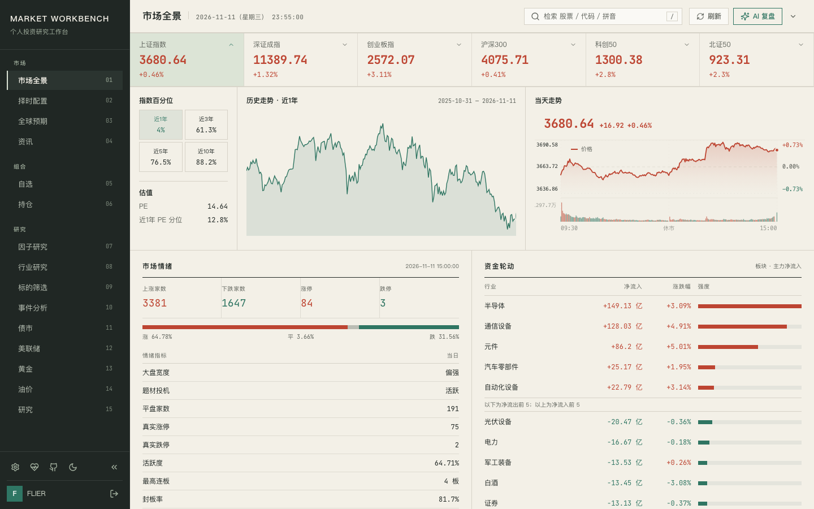
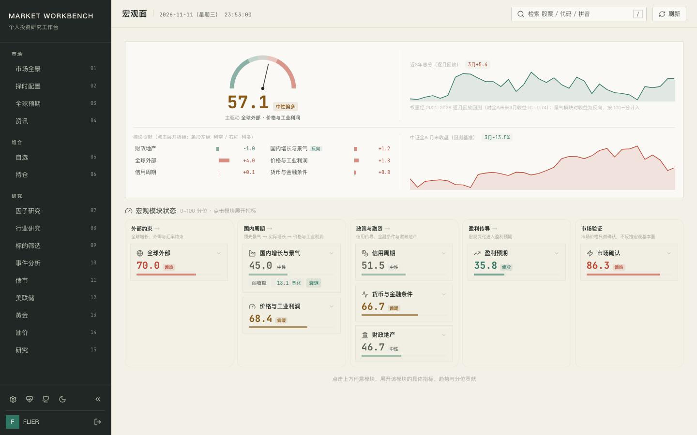
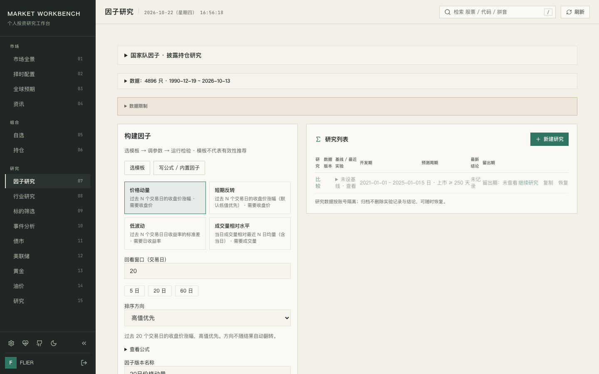
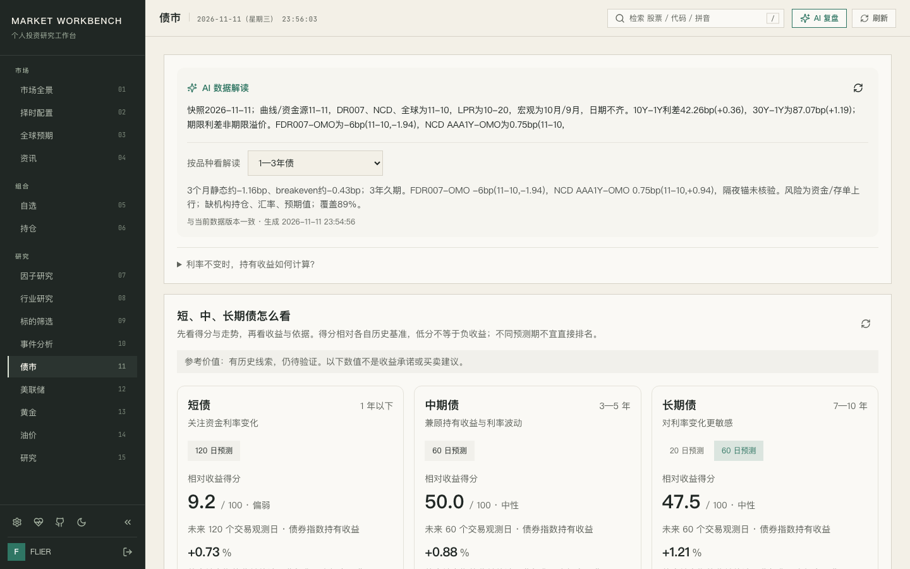
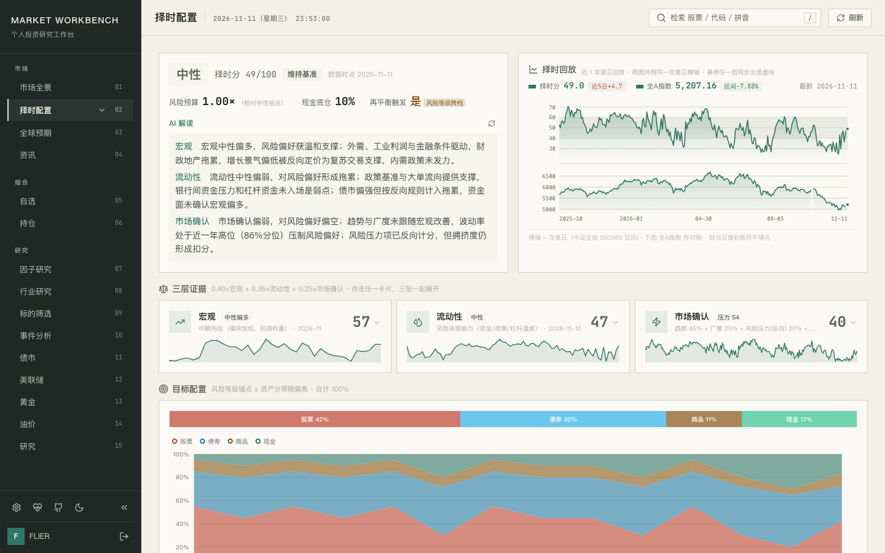
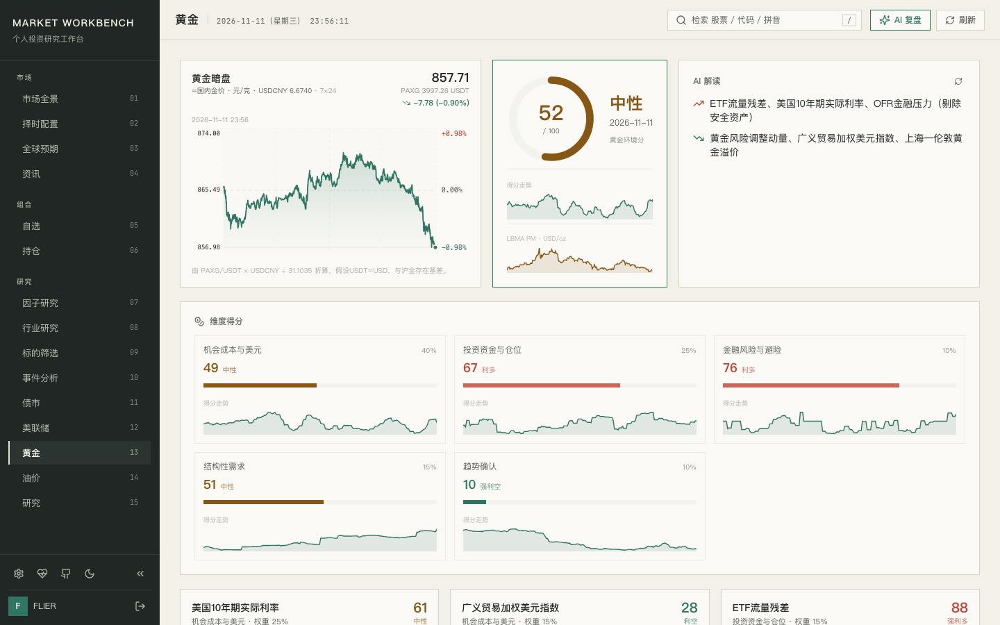
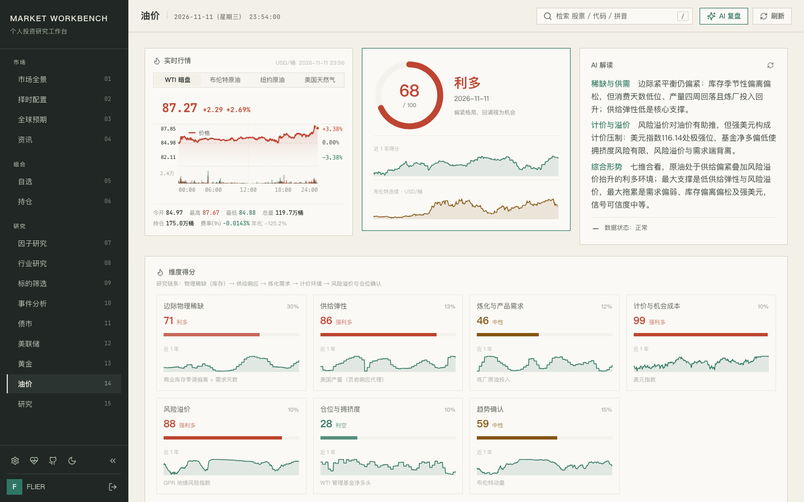
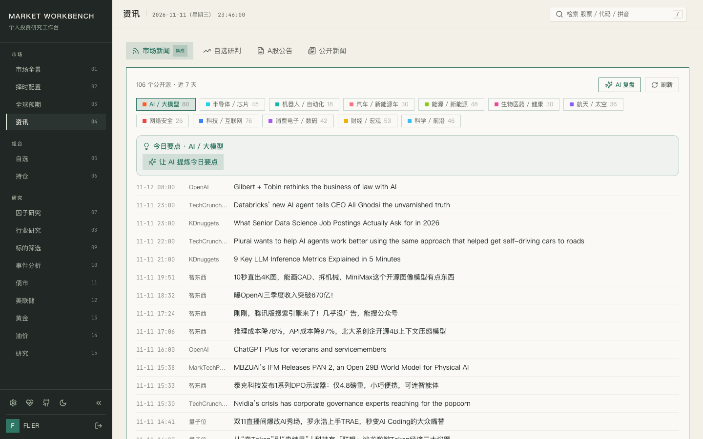
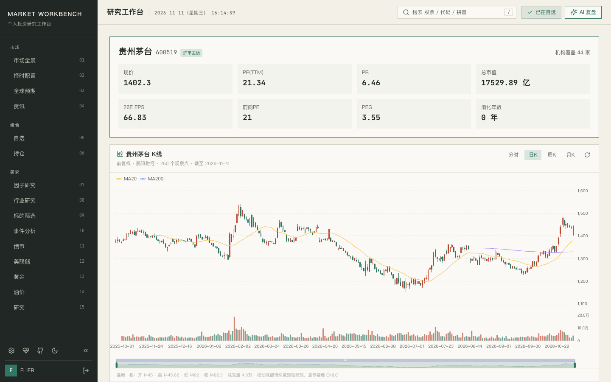

<div align="center">

# Market Workbench

[简体中文](README.md) · [English](README_en.md) · [Changelog](CHANGELOG.md) · [Roadmap](ROADMAP.md)

[](CHANGELOG.md)
[](https://www.python.org/)
[](https://react.dev/)
[](LICENSE)

</div>

A self-hosted research application for China A-shares, with Hong Kong and US market coverage. It includes quotes, financials, macro data, industries, bonds, gold, oil and factor research, as well as watchlists, portfolios, reports and notes. AI uses your own API or local CLI.

## Highlights

- **Local data**: accounts, portfolios and reports are stored in `~/.market-workbench/` by default.
- **Public data sources**: Eastmoney, Tencent, Sina, AkShare, FRED, EIA, IMF, Polymarket, Kalshi and others; most sources do not require an API key.
- **Pluggable AI**: use an OpenAI-compatible API or a local CLI such as Claude Code, Codex, Qwen, Gemini or DeepSeek. AI settings are stored in the browser.
- **One data layer for UI and agents**: the FastAPI HTTP API and dependency-free MCP server share 43 data tools.
- **Visible data status**: pages identify sources, update times and fallback states; cached snapshots are not presented as live data.



<details>
<summary>View more screenshots</summary>

| Macro | Factor research |
|---|---|
|  |  |

| Bonds | Timing and allocation |
|---|---|
|  |  |

| Gold | Oil |
|---|---|
|  |  |

| News | Stock detail |
|---|---|
|  |  |

</details>

## Quick start

### Requirements

- Python 3.10+
- Node.js 20+
- macOS or Linux; `run.sh` requires Bash

### Install and run

```bash
git clone https://github.com/FLIER001/Market-Workbench.git
cd Market-Workbench

cd backend
python3 -m venv .venv
.venv/bin/pip install -r requirements.txt
cd ..

./run.sh
```

Open <http://127.0.0.1:8900>. `run.sh` builds the frontend when its output is missing or stale, then serves both the UI and API from one FastAPI process.

When the user database is empty, register the primary account in the browser. Manage subsequent accounts from the command line:

Run the following commands from `backend/`. If you omit the password argument, the CLI prompts for it without displaying what you type.

```bash
cd backend

# Add an account and prompt for a password of at least 6 characters
.venv/bin/python add_user.py add <username>

# List all accounts
.venv/bin/python add_user.py list

# Reset a password and revoke all login sessions for that account
.venv/bin/python add_user.py passwd <username>

# Permanently delete the account, its user data, portfolios and login sessions
.venv/bin/python add_user.py remove <username>
```

For setup verification and common problems, see the [getting-started guide](docs/getting-started.md).

## Feature map

| Area | Capabilities |
|---|---|
| **Markets and portfolios** | A-share and global market overview, index and valuation percentiles, sentiment, sector flows and public news; grouped watchlists, stock and fund portfolios, return tracking, portfolio diagnostics and historical scenario replay; event calendar for the next 7 / 30 / 90 days |
| **Macro and allocation** | Macro module scores and composite score card, China/US liquidity composites, timing and allocation with historical replay, Polymarket / Kalshi probability panels, and Fed probabilities derived from ZQ futures compared with prediction markets |
| **Securities research** | A-share, Hong Kong and US quotes, charts, valuation, financials, filings, reports and fund flows; A-share earnings previews and event studies; insider and shareholder increase analysis |
| **Industries and screening** | Shenwan industry and thematic-board scores, industry-chain stages and profit distribution, Manager-First fund screening, and natural-language or rule-based stock screening |
| **Factor research** | RankIC, quintile returns, turnover and portfolio backtests; price-volume and point-in-time financial factors, custom formulas, saved versions, comparisons, backtest reports and neighbouring-parameter sensitivity |
| **Other assets** | Bond yield curves, holding and stress scenarios, maturity candidate priors; gold environment and volatility research; oil scoring and WTI off-hours quotes |
| **Personal research library** | Report archive, research notes and reflection review |
| **Runtime status** | Upstream probes, dataset timestamps and source health |

Macro scores, timing allocation, bond priors, gold and oil indicators, and factor backtests are research tools. Some experimental indicators have not passed independent out-of-sample validation. Public data may be delayed, incomplete or rate-limited.

## AI and MCP

**Use AI in the web UI**: open **Settings → Connect AI**, choose a local CLI, or enter an OpenAI-compatible API endpoint, model and key. Settings stay in browser storage and are sent to the local backend only when making a model request.

**Give a local agent access to the data tools**: for Claude Code, run this from the repository root:

```bash
claude mcp add market-workbench -- \
  "$(pwd)/backend/.venv/bin/python" "$(pwd)/backend/mcp_server.py"
```

The MCP server shares the web application's data-tool layer and does not need an API key for local use. See the [backend documentation](backend/README.md) for HTTP API groups and tool details.

## Configuration and deployment

No extra configuration is needed for local use. Set environment variables only when changing ports or data paths, or when exposing the service to other machines:

| Variable | Default | Purpose |
|---|---|---|
| `MW_HOST` / `MW_PORT` | `127.0.0.1` / `8900` | Listen address and port |
| `MW_DATA_DIR` / `MW_REPORTS_DIR` | `~/.market-workbench/` | User data and report directories |
| `MW_ENV_FILE` | `backend/.env.local` | Private configuration loaded by `run.sh` |
| `MW_ALLOW_ORIGINS` | `*` | CORS origin allowlist |
| `MW_API_KEY` | empty | Enables Bearer authentication for the API, except health checks |
| `MW_ALLOW_REGISTRATION` | off | Set to `1` to allow web registration |
| `MW_DATA_PROXY` | off | Set to `1` to use the system proxy for data requests |

See the [configuration guide](docs/configuration.md) and [environment example](backend/.env.example) for all variables, optional source keys and public-deployment requirements. Before exposing the service, restrict CORS, set a strong API key, and enable HTTPS on the reverse proxy.

## Development and architecture

```text
React 19 + TypeScript + Vite
              │
              ▼
FastAPI :8900 ── public market data / local SQLite and files / your AI or CLI
     │
     ├── serves frontend/dist
     └── MCP server (stdio, shared data-tool layer)
```

For frontend hot reloading, also run `cd frontend && npm run dev`. Vite uses port 5899 and proxies `/api` to 8900.

```bash
# Backend tests
cd backend && .venv/bin/python -m pytest tests -q

# Frontend tests and production build
cd frontend && npm test && npm run build
```

Backend modules are separated by topic, score rebuilds use short-lived worker processes, and `frontend/package.json` is the version source of truth. See the [architecture guide](docs/architecture.md) for module boundaries and data flow.

## Scope and limitations

Market Workbench organizes public data and information entered by the user. Its output is for research reference only and is not investment advice or a promise of returns. Verify sources and timestamps, and make decisions independently.

Methodology and limitations for bonds V2 and gold V3 live in local research notes that are not part of the repository; the factor lab API contract is in [the architecture notes](docs/architecture.md).

## Acknowledgements and license

Market Workbench is derived from [simonlin1212/Vibe-Research](https://github.com/simonlin1212/Vibe-Research). It retains the public-data and pluggable-AI foundation while extending macro, asset-allocation, industry, factor and cross-asset research.

[MIT License](LICENSE)
